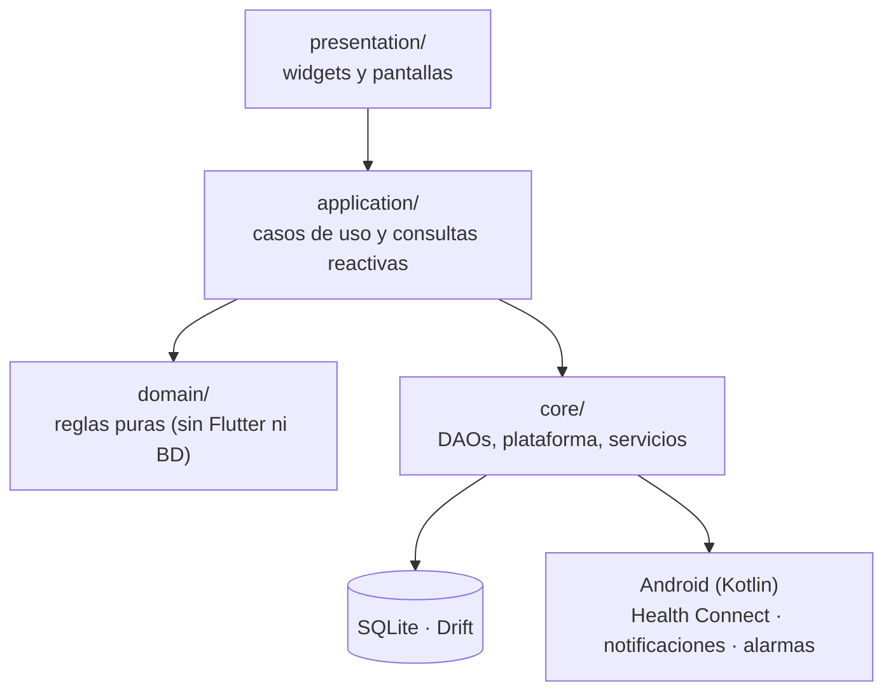

# 02 · Arquitectura

NB Selfcare es una app Flutter organizada **por funcionalidad** y, dentro de cada una, **por capas**. El estado y la inyección de dependencias usan Riverpod 3; la persistencia, Drift sobre SQLite; la navegación, go_router.

## 1. Capas



| Capa | Contenido | Regla |
| :-- | :-- | :-- |
| `presentation/` | Pantallas, hojas, tarjetas. | Lee con *providers* de `application/` y escribe con sus servicios. Nunca importa un DAO (guardrail 10). |
| `application/` | Servicios (`WeighInService`, `FoodLoggingService`, `PetService`…) y consultas (`todayOverviewProvider`, `nibiOverviewProvider`…). | Orquesta transacciones, recompensas y efectos nativos. |
| `domain/` | Reglas puras: `RewardPolicy`, `NibiMoodResolver`, `BreathingSession`, `WeighInAnalyzer`, `WeeklyProtocol`… | Sin E/S; 100 % testeables. |
| `core/` | Base de datos y DAOs, pasarelas de plataforma, servicios transversales (backup, Open Food Facts, OCR, PDF, analítica). | No depende de `features/` (guardrail 9). |
| `shared/` | Sistema de diseño (`theme/`), utilidades (fechas, números, fórmulas) y widgets comunes. | No depende de `features/`. |

## 2. Estructura

```text
lib/
├── main.dart · app.dart          # Arranque, tema, localización
├── app/
│   ├── router/app_router.dart     # StatefulShellRoute con 5 pestañas + rutas sueltas
│   └── widgets/                   # Barra inferior y barra de ayuno persistente
├── core/
│   ├── clock/                     # Clock inyectable (única fuente de la hora)
│   ├── database/                  # tables.dart, app_database.dart (v7), daos/, seeder/
│   ├── domain/                    # Enums y reglas compartidas (fases del ayuno, rachas, energía)
│   ├── hardware/                  # BodyScaleDriver + driver de la Xiaomi Mi Scale 2
│   ├── l10n/                      # ARB en español y código generado
│   ├── platform/                  # Pasarelas a Android (callNative / bestEffort)
│   └── services/                  # Backup, Open Food Facts, OCR, PDF, analítica cruzada…
├── features/
│   ├── today/                     # Inicio: disposición, tarjetas, diario rápido, domingo
│   ├── nutrition_hydration/       # Comida y agua
│   ├── body_metrics/              # Báscula, peso, cinta, entrenamientos, metas, ciclo
│   ├── care/                      # Cuidado: tratamientos, hábitos, suelo pélvico, pausas, signos vitales…
│   ├── fasting/                   # Ayuno
│   ├── journal/                   # Diario, cafeína, digestión
│   ├── pet_gamification/          # Nibi, monedas, tienda, respiración
│   ├── profile_goals/             # Perfil, metas, ajustes, recordatorios, suplementos
│   └── protocol/                  # Protocolo semanal
└── shared/
    ├── theme/                     # ScColors, tokens (espacios, radios, movimiento, tipografía), 24 temas
    ├── utils/                     # Fechas, números, fórmulas biométricas, metas diarias
    └── widgets/                   # HealthCard, MetricValue, anillos, barras, hojas…
```

## 3. Navegación

Seis pestañas en un `StatefulShellRoute` (cada una conserva su estado y sus tickers se pausan cuando no está visible): `/hoy`, `/comer`, `/cuerpo`, `/cuidado`, `/nibi`, `/perfil` (ADR-15). Fuera del armazón: `/ayuno`, `/protocolo`, `/ajustes`, `/privacidad` (exigida por Health Connect) y `/onboarding`. Sin perfil, el router redirige a la bienvenida.

## 4. Flujo de datos

1. Las pantallas observan *streams* de Drift combinados en un modelo por pantalla (`TodayOverview`, `NibiOverview`, `NutritionDay`…). Cualquier escritura se refleja sola, sin "recargar".
2. Las escrituras con reglas pasan por un caso de uso que abre una transacción. Ejemplo, un pesaje (`WeighInService`):
   - guarda la medición con su peso tendencia (EMA α = 0,1) y métricas de bioimpedancia;
   - evalúa la "falsa subida" (sodio, carbohidratos, agua);
   - otorga monedas una vez al día (`RewardService` + `RewardPolicy`, con multiplicador de sueño);
   - si tocan los 14 días, recalibra el gasto diario (`TdeeCalibrationService`);
   - fuera de la transacción, exporta peso y grasa a Health Connect con `bestEffort` (un fallo nativo nunca deshace el registro).
3. La hora sale siempre de `Clock` (`clockProvider`): los tests fijan el tiempo y ninguna regla llama a `DateTime.now()` (guardrail 7). Los días de calendario usan `addDays`/`calendarDaysSince`, seguros ante cambios de horario.

## 5. Plataforma Android

Tres canales, todos con `callNative` (nunca lanza; un tipo inesperado o un método ausente devuelve `null`):

| Canal | Kotlin | Uso |
| :-- | :-- | :-- |
| `com.nb.selfcare/health_connect` | `HealthConnectBridge` | Permisos, lectura de pasos, sueño (fases y hora de despertar), FC en reposo y signos vitales declarados; escritura de peso, grasa, hidratación y sesiones de respiración. |
| `com.nb.selfcare/notifications` | `FastingNotifier`, `ReminderScheduler`, `ReminderActionReceiver`, `MovementNudgeWorker` | Cronómetro del ayuno en la pantalla de bloqueo, recordatorios con `AlarmManager` (se reprograman al reiniciar) con botón "Hecho" para las tomas, pausas activas. |
| `com.nb.selfcare/system` | `MainActivity` | Permisos en tiempo de ejecución, ajustes de la app, dictado en el dispositivo disponible, acción de arranque, modelo del teléfono, marcador y vibración (`DeviceGateway`). |

## 6. Dependencias

| Paquete | Para qué |
| :-- | :-- |
| `flutter_riverpod`, `go_router`, `intl` | Estado, navegación, formatos. |
| `drift`, `drift_flutter`, `sqlite3` | SQLite con FTS5 empaquetado. |
| `universal_ble` | Báscula por Bluetooth LE (licencia OSI). |
| `http` | Solo Open Food Facts (guardrail 1b). |
| `mobile_scanner`, `google_mlkit_text_recognition`, `image_picker` | Escáner y OCR en el dispositivo (ADR-13). |
| `file_picker`, `share_plus` | Exportar e importar la copia `.sqlite`. |
| `pdf`, `printing` | Informe clínico. |
| `speech_to_text` | Dictado, solo con reconocimiento en el dispositivo. |
| `dynamic_color` | Tema "Colores de tu fondo" (Material You). |

Prohibido: Firebase, analytics, crash reporters remotos, `google_fonts` (descarga en tiempo de ejecución) y `flutter_blue_plus` (licencia no OSI). Las fuentes (Space Grotesk y Manrope) van empaquetadas.

## 7. Guardrails automáticos

`test/qa_audit/architecture_guardrails_test.dart` falla si:

1. aparece un SDK de nube o telemetría, o `http` fuera de Open Food Facts;
2. hay `TODO`/`FIXME` o código truncado en `lib/`;
3. hay `dynamic` sin necesidad en DAOs y fórmulas;
4. `android:allowBackup` no es `false`;
5. la mascota usa lenguaje de muerte, enfermedad o culpa;
6. se llama a `DateTime.now()` fuera de `core/clock`;
7. la UI escribe saltándose un caso de uso, o importa DAOs;
8. `core/` o `shared/` dependen de `features/`.
