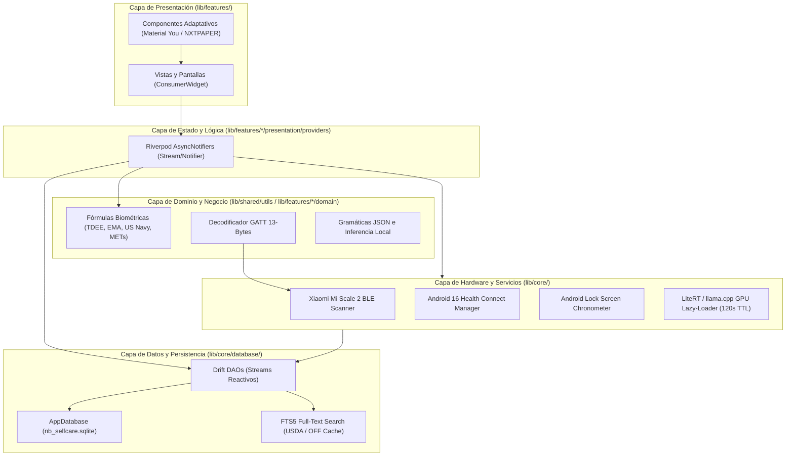

# 02 · Arquitectura del Sistema (`docs/02_ARCHITECTURE.md`)

> **Contexto Técnico:** Define la topología de capas, flujo de datos unidireccional, gestión de dependencias y aislamiento estricto *Offline-First* para **NB Selfcare** (`com.nb.selfcare`).

---

## 1. Principio Arquitectónico: Unidireccional y Reactivo

NB Selfcare sigue una arquitectura modular en capas basada en **Feature-First** con **Riverpod 3.x** para inyección de dependencias y gestión de estado reactivo, y **Drift (SQLite3 + FTS5)** como fuente única de verdad (*Single Source of Truth*).



---

## 2. Estructura de Directorios (`lib/`)

```text
lib/
├── main.dart                                  # Entrypoint: SQLite hooks, Riverpod Scope, permisos
├── app.dart                                   # MaterialApp, DynamicColor, conmutador NXTPAPER E-Ink, go_router
├── core/
│   ├── constants/
│   │   ├── app_constants.dart                 # Constantes generales, versiones, keys
│   │   ├── ble_uuids.dart                     # 0x181B, 0x2A9C, vendor UUIDs
│   │   └── met_constants.dart                 # Tabla oficial METs por categoría y RPE
│   ├── database/
│   │   ├── app_database.dart                  # Drift Database, PRAGMA WAL, migraciones, VACUUM INTO
│   │   ├── tables.dart                        # Las 14 tablas relacionales del sistema
│   │   ├── daos/                              # DAOs especializados con consultas reactivas (Streams)
│   │   │   ├── user_profile_dao.dart
│   │   │   ├── body_measurements_dao.dart
│   │   │   ├── food_dao.dart                  # FTS5 Match + CRUD de alimentos y combos
│   │   │   ├── hydration_dao.dart             # Registro atómico de vasos y exportación HC
│   │   │   ├── fasting_dao.dart
│   │   │   ├── workout_dao.dart
│   │   │   ├── journal_dao.dart
│   │   │   ├── pet_dao.dart                   # PetStatus + CoinLedger
│   │   │   ├── reminders_dao.dart
│   │   │   └── health_sync_dao.dart           # Control de outbox / checkpoints Health Connect
│   │   └── seeder/
│   │       └── database_seeder.dart           # Semilla USDA español y catálogo inicial de tienda
│   ├── hardware/
│   │   ├── body_scale_driver.dart             # Contrato abstracto para básculas comunitarias
│   │   └── drivers/
│   │       └── xiaomi_miscale2_driver.dart    # Parser 13 bytes BLE + bioimpedancia inversa
│   ├── l10n/
│   │   ├── arb/                               # Archivos ARB (app_es.arb plantilla principal)
│   │   └── generated/                         # Código autogenerado por flutter gen-l10n
│   ├── services/
│   │   ├── health_connect_service.dart        # Lectura/Escritura API 36 Health Connect
│   │   ├── local_ai_service.dart              # Lazy-loader RAM/GPU (120s TTL) para Qwen / Gemma
│   │   ├── notification_service.dart          # Cronómetro en pantalla de bloqueo y alarmas exactas
│   │   ├── backup_service.dart                # VACUUM INTO atómico + importación con validación
│   │   └── open_food_facts_service.dart       # Consulta con caché inmediata en SQLite
│   └── theme/
│       ├── app_theme.dart                     # Material 3 Monet (Dynamic Color)
│       └── nxtpaper_eink_theme.dart           # Tema papel mate, 0 elevation, bordes 1.5px
├── features/
│   ├── dashboard/                             # Tab 1: Hábitat Mascota, Anillos, Bento Grid, Dock
│   ├── nutrition_hydration/                   # Tab 2: Escáner OFF, FTS5 USDA, Combos, Agua, Parser IA
│   ├── body_metrics/                          # Tab 3: Pesaje BLE en vivo, EMA, Falsa Subida, Cinta, RPE
│   ├── fasting/                               # Tab 4: Cronómetro ayuno, fases metabólicas, alarmas
│   ├── journal_analytics/                     # Tab 5: Diario privado, NLP local, correlaciones
│   ├── profile_goals/                         # Perfil dinámico, edad calculada, TDEE adaptativo (14d)
│   └── pet_gamification/                      # ProceduralPetCanvas, tienda, libro mayor, escudo racha
└── shared/
    ├── utils/
    │   ├── biometric_formulas.dart            # Katch-McArdle, US Navy, METs, EMA, retención
    │   └── date_time_extensions.dart          # Formato dateKey 'YYYY-MM-DD', cálculos cronológicos
    └── widgets/
        ├── nxtpaper_card.dart                 # Tarjeta con borde 1.5px adaptativa
        └── reactive_macro_ring.dart           # Anillo radial reactivo sin lag
```

---

## 3. Flujo de Datos y Grafo Reactivo en Drift

La base de datos SQLite no es un almacén pasivo; actúa como el **grafo de eventos central**:

1. **Lectura Continua:** Las vistas de la UI se suscriben a streams provistos por los DAOs (ej. `watchTodaySummary(dateKey)` o `watchWeightTrend(limit: 30)`).
2. **Escritura Transaccional:** Cada acción (un pesaje estabilizado de la báscula, un vaso de agua, una comida dictada) realiza un `INSERT` en su tabla correspondiente dentro de una transacción.
3. **Efectos en Cascada Automáticos:**
   * Al insertar un pesaje en `body_measurements`:
     - Se calcula inmediatamente la nueva **EMA (Peso Tendencia)**.
     - Se evalúa si hay **Falsa Subida** (cruzando sodio/carbohidratos del día anterior o delta de agua BIA).
     - Se escribe el peso y grasa corporal en **Health Connect**.
     - Se actualiza el balance de monedas en `coin_ledger` (+15 monedas, multiplicador de sueño si aplica).
     - Si han transcurrido 14 días desde la última calibración, se dispara el recálculo del **TDEE Adaptativo**.
   * Todo componente suscrito a estos datos se actualiza sin navegación forzada ni llamadas manuales de recarga.

---

## 4. Política de Dependencias y Seguridad Offline

* **Prohibido:** Cualquier paquete que incluya Firebase, Google Analytics, Sentry remoto, Crashlytics o conexiones a servidores propietarios.
* **Fuentes Tipográficas:** Prohibido `google_fonts` que descargue fuentes en runtime; las fuentes necesarias (ej. Atkinson Hyperlegible Next) se empaquetan en `assets/fonts/` con licencia abierta.
* **Bluetooth:** Uso de bibliotecas con licencia libre OSI (como `universal_ble` con driver modular) para garantizar portabilidad y cumplimiento de licenciamiento estricto.
* **Almacenamiento de Red:** Todo request a Open Food Facts persiste el producto en la tabla `food_items` local y en el índice `FTS5` antes de mostrarlo en pantalla. Si la red falla, la app opera al 100% con su catálogo local.

