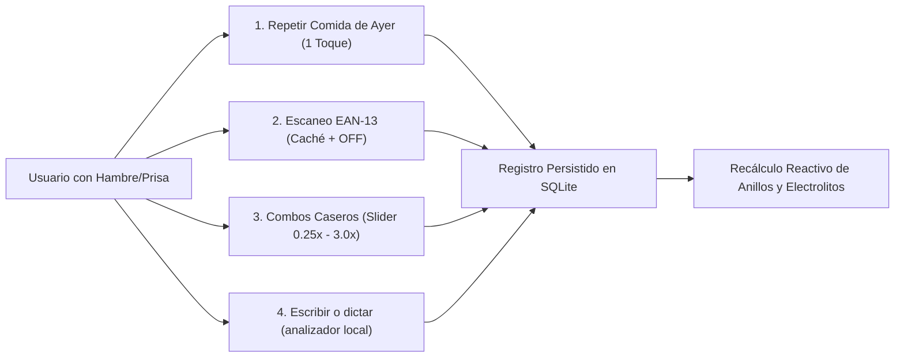

# 05 · Nutrición e hidratación

> **Contexto Técnico:** Arquitectura del subsistema nutricional sin fricción (< 15 segundos), escáner EAN-13 con Open Food Facts, base local USDA en español, combos caseros con escalador, semáforo de electrolitos y registro de hidratación.

---

## 1. Principios de Interacción (< 15 Segundos)

El registro nutricional tradicional falla por fatiga de decisión y formularios lentos. NB Selfcare optimiza 4 flujos prioritarios:

---

## 2. Flujo 1: Escáner de Código de Barras (Open Food Facts + Caché FTS5)

1. **Lectura visual:** `mobile_scanner` con el modelo de ML Kit empaquetado en la app: funciona sin conexión y sin Google Play Services (ADR-13). Sin permiso de cámara se ofrece abrir Ajustes, escribir el código o leer la etiqueta.
2. **Jerarquía de Búsqueda:**
   * **Paso A (Caché Local):** `SELECT * FROM food_items WHERE barcode = ?`. Si existe, abre inmediatamente el selector de porciones en $< 50\text{ ms}$.
   * **Paso B (Consulta Externa OFF):** Si no está en caché y hay conexión de red, consulta la API pública de **Open Food Facts**. Normaliza todos los campos a $100\text{ g}$, extrae `nutriScore` (`A`–`E`), persiste el producto en `food_items` y dispara los triggers de `food_items_fts`.
   * **Paso C (alta sin conexión):** si no hay red o el código no existe en OFF, se abre el alta guiada (o la **lectura de la etiqueta nutricional** con OCR en el dispositivo, que entiende "kJ / kcal" y sal → sodio) y el código queda asociado para siempre.

---

## 3. Flujo 2: Semilla Nutricional USDA en Español y Triángulo de Electrolitos

A diferencia de las bases de datos comunitarias saturadas de entradas duplicadas e incompletas, NB Selfcare incluye una semilla de unos **165 alimentos** con valores de la **USDA** (FoodData Central, por 100 g y con porción habitual), traducidos y adaptados al español latinoamericano (`core/database/seeder/seed_foods.dart`). Las instalaciones anteriores reciben los alimentos nuevos al abrir la app, sin tocar los existentes; `seed_foods_test` comprueba que no haya nombres repetidos y que la energía cuadre con los macronutrientes:
* Carnes, aves, pescados, huevos y lácteos.
* Frutas, vegetales, legumbres, tubérculos y cereales (arroz, avena, arepa, quinoa).
* Semillas, frutos secos y aceites.
* Bebidas, salsas, dulces y platos habituales (arroz con pollo, huevos pericos, empanada, pizza…).

### El Triángulo Electrolítico y Esenciales (ADR-02)

La UI prioriza los minerales críticos del rendimiento físico y ayuno:
1. **Sodio ($\text{mg}$):** Meta base $1500\text{–}2300\text{ mg}$ (aumentada en deportistas y cetosis).
2. **Potasio ($\text{mg}$):** Meta base $3400\text{–}4700\text{ mg}$.
3. **Magnesio ($\text{mg}$):** Meta base $320\text{–}420\text{ mg}$.
4. **Micronutrientes Clave:** Fibra ($\text{g}$), Calcio ($\text{mg}$), Hierro ($\text{mg}$), Zinc ($\text{mg}$), Vitaminas C ($\text{mg}$), D ($\mu\text{g}$) y B12 ($\mu\text{g}$).

> **Regla de Honestidad de Datos:** Si un producto industrializado no declara magnesio o potasio en su etiqueta, la UI muestra un indicador de `Dato no reportado` en lugar de una barra en cero, para evitar falsos diagnósticos de deficiencia.

---

## 4. Flujo 3: Combos Caseros con Escalador Proporcional

Un `MealCombo` agrupa varios alimentos base en porciones estándar (1.0x).
Al registrar una comida habitual (ej. *"Desayuno de Entrenamiento"*):
* El usuario selecciona el combo.
* Un `Slider` táctil con paradas rápidas ($0.25\times$, $0.5\times$, $0.75\times$, $1.0\times$, $1.25\times$, $1.5\times$, $2.0\times$, $3.0\times$) multiplica simultáneamente todos los ingredientes.
* Con 2 toques, se insertan los registros en `food_logs` preservando la granularidad de los ingredientes.
* **Repetir Ayer:** En cada bloque horario (`breakfast`, `lunch`, `dinner`, `snack`), un botón copia íntegramente los alimentos registrados a esa misma hora el día anterior con opción inmediata de `Deshacer`.

---

## 5. Flujo 4: Escribir o dictar una comida

* **Voz:** reconocimiento de Android **solo en el dispositivo** (`SpeechGateway`); si el teléfono no lo ofrece sin conexión, el micrófono no aparece y nunca se envía audio a la nube.
* **Texto → alimentos:** `TextAssistant.parseMealText` es un analizador determinista (sin modelos de lenguaje): separa por comas e "y", reconoce cantidades ("200g", "2 huevos", "media taza", "un plátano") y unidades caseras, y busca cada término en el catálogo con FTS5. Los alimentos que no encuentra se registran con valores de respaldo estimados.
* Antes de guardar siempre aparece la **revisión editable**: gramos con ±, quitar ingredientes y elegir el momento de comida.
* Cantidades absurdas ("0 g de arroz", "200000 huevos") se descartan o acotan.

---

## 6. Registro Atómico de Hidratación

* Botones rápidos en Inicio y en Comida: `+250 ml`, `+500 ml` y vasos personalizados.
* Cada vaso genera un registro en `hydration_logs` con su timestamp exacto.
* `HydrationService` exporta cada vaso a Health Connect con su volumen e instante (si hay permiso; un fallo nunca deshace el registro).
* Recompensa: Al alcanzar el $100\%$ de la meta hídrica diaria, se otorga $+15$ monedas en `CoinLedger` (con multiplicador de sueño si aplica).

