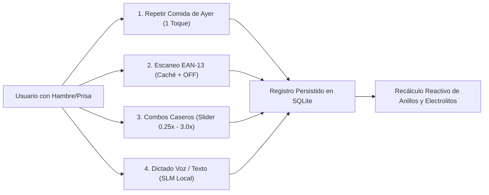

# 05 · Motor de Nutrición, Micronutrientes e Hidratación (`docs/05_NUTRITION_ENGINE.md`)

> **Contexto Técnico:** Arquitectura del subsistema nutricional sin fricción (< 15 segundos), escáner EAN-13 con Open Food Facts, base local USDA en español, combos caseros con escalador, semáforo de electrolitos y registro de hidratación.

---

## 1. Principios de Interacción (< 15 Segundos)

El registro nutricional tradicional falla por fatiga de decisión y formularios lentos. NB Selfcare optimiza 4 flujos prioritarios:



---

## 2. Flujo 1: Escáner de Código de Barras (Open Food Facts + Caché FTS5)

1. **Lectura Visual:** Decodificador de códigos de barras sobre la cámara (sin servicios propietarios de Google Play).
2. **Jerarquía de Búsqueda:**
   * **Paso A (Caché Local):** `SELECT * FROM food_items WHERE barcode = ?`. Si existe, abre inmediatamente el selector de porciones en $< 50\text{ ms}$.
   * **Paso B (Consulta Externa OFF):** Si no está en caché y hay conexión de red, consulta la API pública de **Open Food Facts**. Normaliza todos los campos a $100\text{ g}$, extrae `nutriScore` (`A`–`E`), persiste el producto en `food_items` y dispara los triggers de `food_items_fts`.
   * **Paso C (Alta Rápida Offline):** Si no hay red o el código no existe en OFF, presenta una tarjeta simple de 4 campos esenciales (Nombre, Kcal, Proteína, Carbos, Grasa por 100g) y asocia ese código para siempre en el dispositivo.

---

## 3. Flujo 2: Semilla Nutricional USDA en Español y Triángulo de Electrolitos

A diferencia de las bases de datos comunitarias saturadas de entradas duplicadas e incompletas, NB Selfcare incluye una semilla pre-compilada de alimentos naturales de la **USDA** traducidos y adaptados al español latinoamericano:
* Carnes, aves, pescados, huevos y lácteos.
* Frutas, vegetales, legumbres, tubérculos y cereales (arroz, avena, arepa, quinoa).
* Semillas, frutos secos y aceites vírgenes.

### El Triángulo Electrolítico y Esenciales (ADR-02)

La UI prioriza los minerales críticos del rendimiento físico y ayuno:
1. **Sodio ($\text{mg}$):** Meta base $1500\text{–}2300\text{ mg}$ (aumentada en deportistas y cetosis).
2. **Potasio ($\text{mg}$):** Meta base $3400\text{–}4700\text{ mg}$.
3. **Magnesio ($\text{mg}$):** Meta base $320\text{–}420\text{ mg}$.
4. **Micronutrientes Clave:** Fibra ($\text{g}$), Calcio ($\text{mg}$), Hierro ($\text{mg}$), Zinc ($\text{mg}$), Vitaminas C ($\text{mg}$), D ($\mu\text{g}$) y B12 ($\mu\text{g}$).

> **Regla de Honestidad de Datos:** Si un producto industrializado no declara magnesio o potasio en su etiqueta, la UI muestra un indicador de `Dato no reportado` en lugar de una barra en cero, para evitar falsos diagnósticos de deficiencia.

---

## 4. Flujo 3: Combos Caseros con Escalador Proporcional

Un `MealCombo` agrupa varios alimentos base en porciones estándar (1.0x).
Al registrar una comida habitual (ej. *"Desayuno de Entrenamiento"*):
* El usuario selecciona el combo.
* Un `Slider` táctil con paradas rápidas ($0.25\times$, $0.5\times$, $0.75\times$, $1.0\times$, $1.25\times$, $1.5\times$, $2.0\times$, $3.0\times$) multiplica simultáneamente todos los ingredientes.
* Con 2 toques, se insertan los registros en `food_logs` preservando la granularidad de los ingredientes.
* **Repetir Ayer:** En cada bloque horario (`breakfast`, `lunch`, `dinner`, `snack`), un botón copia íntegramente los alimentos registrados a esa misma hora el día anterior con opción inmediata de `Deshacer`.

---

## 5. Flujo 4: Dictado por Voz y Texto con IA Local Híbrida

* Entrada por voz: Decodificada localmente en el dispositivo mediante la API de voz on-device de Android.
* El texto (ej. *"200g de pechuga de pollo, 150g de arroz y 1 manzana"*) entra al servicio `LocalAiService`.
* El SLM local extrae el contrato JSON determinista:
  ```json
  {
    "items": [
      {"search_term": "pechuga de pollo", "grams": 200, "fallback_kcal": 330, "fallback_p": 62, "fallback_c": 0, "fallback_f": 7},
      {"search_term": "arroz blanco cocido", "grams": 150, "fallback_kcal": 195, "fallback_p": 4, "fallback_c": 43, "fallback_f": 0.5},
      {"search_term": "manzana", "grams": 180, "fallback_kcal": 94, "fallback_p": 0.5, "fallback_c": 25, "fallback_f": 0.3}
    ]
  }
  ```
* El DAO ejecuta búsquedas `FTS5` para enlazar cada término con el catálogo local verificado.
* Se presenta una hoja previa editable de 1 toque para confirmar o ajustar antes de persistir.

---

## 6. Registro Atómico de Hidratación

* Botones rápidos en el Dashboard y pantalla de Nutrición: `+250 ml`, `+500 ml`, vaso personalizado.
* Cada vaso genera un registro en `hydration_logs` con su timestamp exacto.
* El servicio `HealthConnectService` exporta asíncronamente los registros de hidratación a Android 16 Health Connect con su volumen e instante de ingesta.
* Recompensa: Al alcanzar el $100\%$ de la meta hídrica diaria, se otorga $+15$ monedas en `CoinLedger` (con multiplicador de sueño si aplica).

