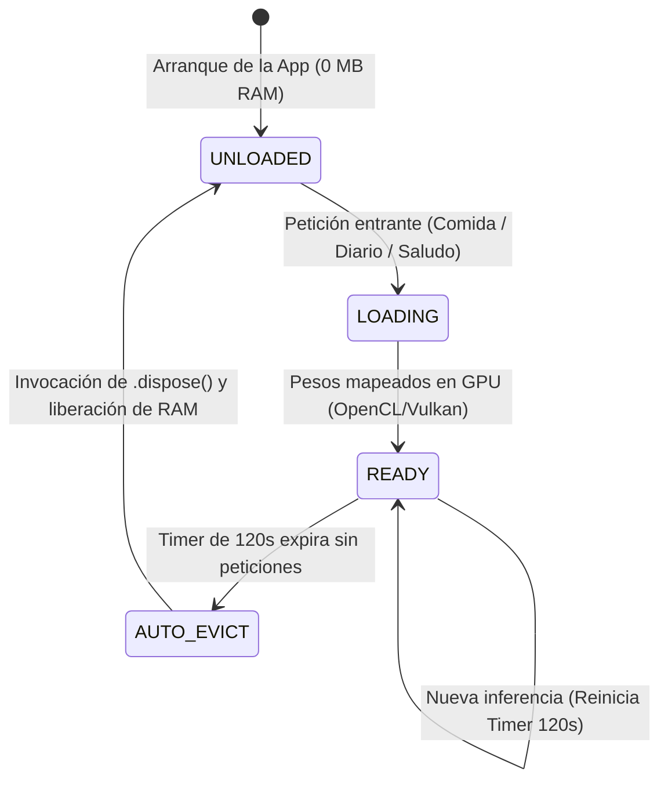

# 08 · Motor de IA Local y Gamificación Positiva (`docs/08_LOCAL_AI_AND_GAMIFICATION.md`)

> **Contexto Técnico:** Ciclo de vida de memoria GPU para inferencia LLM local (MediaPipe LiteRT / `llama.cpp`), esquemas JSON deterministas, lienzo procedural de la mascota (`Nibi`) y libro mayor de recompensas (`CoinLedger`).

---

## 1. Ciclo de Vida de Memoria del Motor de IA Local (`LocalAiService`)

> **Estado (2026-10-26):** aún no hay runtime LLM integrado. `LocalAiService`, que simulaba este ciclo de vida, se reemplazó por `TextAssistant` (`lib/core/services/text_assistant.dart`): motores deterministas con una API asíncrona preparada para enchufar LiteRT/llama.cpp. La UI no promete IA mientras no exista.

NB Selfcare permite la carga opcional de modelos de lenguaje pequeños cuantizados a 4 bits (**Qwen 2.5/3 1.5B–3B Instruct** o **Gemma 3 1B/4B**) ubicados en el almacenamiento del dispositivo (`.task`, `.litertlm` o `.gguf`).

### Máquina de Estados de Memoria (Lazy-Load + Auto-Evict a los 120s)

Para no agotar la memoria RAM del teléfono ($1.0\text{–}1.5\text{ GB}$) cuando la IA no se está utilizando:



* **Degradación Determinista:** Si el usuario no tiene un modelo descargado o la IA está desactivada, el sistema utiliza algoritmos deterministas (búsqueda por palabras clave, selectores numéricos en el diario y banco de 60 frases contextuales para la mascota).

---

## 2. Contratos JSON Deterministas y System Prompts

### A. Parser Sintáctico de Comidas (`parseMealText`)

* **System Prompt:**
  ```text
  Eres un extractor nutricional sintáctico. Convierte el texto del usuario en un objeto JSON válido sin markdown ni explicaciones. Estima el peso en gramos de cada alimento y provee calorías/macros de respaldo por si el alimento no está en la base de datos local.
  Esquema exacto:
  {"items":[{"search_term":"nombre generico singular sin tildes","grams":100,"fallback_kcal":150,"fallback_p":10,"fallback_c":15,"fallback_f":5}]}
  ```
* **Resolución Híbrida:** Cada elemento extraído se busca en la tabla local `food_items_fts`. Si existe, se toman los valores verificados de la USDA/OFF. Si no, se usan temporalmente los campos `fallback_*`.

### B. Analizador Semántico del Diario (`analyzeJournal`)

* **System Prompt:**
  ```text
  Analiza esta entrada de diario personal. Responde UNICAMENTE con un objeto JSON válido siguiendo este esquema:
  {"mood_score":1..5,"energy_level":1..5,"stress_level":1..5,"tags":["max_3_tags_snake_case"],"one_line_insight":"resumen empatico de maximo 18 palabras en español"}
  ```

### C. Saludo Contextual de la Mascota (`generatePetGreeting`)

* **Input String:**
  `PetName: Nibi | SleepHours: 7.8 | FastingHours: 14.5 | WaterMl: 750/2500 | WeightTrendDelta7d: -0.4kg | Streak: 12d`
* **System Prompt:**
  ```text
  Eres Nibi, la mascota virtual de autocuidado del usuario. Basado en los datos biométricos de hoy, escribe UN SOLO mensaje corto (máximo 22 palabras), cálido, ingenioso y sin regaños. Responde solo con el texto plano del mensaje.
  ```

---

## 3. Mascota Virtual Procedural (`ProceduralPetCanvas`)

Para evitar dependencias de archivos externos binarios que puedan fallar en el primer arranque, la mascota se implementa como un lienzo vectorial procedural nativo (`CustomPainter`):

* **Reactividad en Vivo:**
  * **Cetosis de Ayuno (`isFastingKetosis` $\ge 12\text{ h}$):** Despliega un aura luminosa sutil alrededor del personaje.
  * **Hidratación (`hydrationRatio` 0.0–1.0):** Cambia la animación facial y sostiene un vaso de agua al registrar ingesta.
  * **Calidad de Sueño (`sleepQuality` 1–3):** Ojos despiertos y postura enérgica si durmió $\ge 7.5\text{ h}$.
  * **Pesaje BLE en Vivo (`isWeighingIn`):** La mascota se sube a su propia mini báscula mientras los dígitos fluctúan en pantalla.
  * **Accesorios:** Dibuja sobre el lienzo los sombreros equipados (`hat_chef`, `hat_headband`, `hat_zen_halo`) y el fondo de habitación seleccionado.

---

## 4. Economía Positiva del Libro Mayor (`CoinLedger`)

* **Cero Punición:** La mascota nunca muere, nunca enferma ni se degrada por olvidar registrar un día.
* **Multiplicador de Sueño Reparador:** Si `sleepDurationMinutes >= (dailySleepGoalHours * 60)`, todas las monedas ganadas durante el día se multiplican automáticamente por **$1.5\times$** (redondeado hacia arriba).
* **Idempotencia Diaria (Tabla `coin_ledger`):**
  * `weigh_in`: $+15$ monedas (1 al día).
  * `meal_log`: $+10$ monedas por comida registrada (desayuno, almuerzo, cena; máx. $30$/día).
  * `water_goal`: $+15$ monedas al cumplir el $100\%$ de la meta de agua (1 al día).
  * `fast_done`: $+20$ monedas al culminar un ayuno $\ge 14\text{ h}$ (1 al día).
  * `journal_entry`: $+10$ monedas al escribir en el diario (1 al día).
* **Escudos de Racha (`StreakShield`):**
  * Se pueden adquirir en la tienda con monedas del juego (ej. Escudo de 1 día por 40 monedas, Pase de Fin de Semana por 100 monedas).
  * Si el usuario no registra actividad un día, el sistema consume automáticamente 1 escudo disponible y mantiene intacta la racha de días (`currentStreakDays`).

