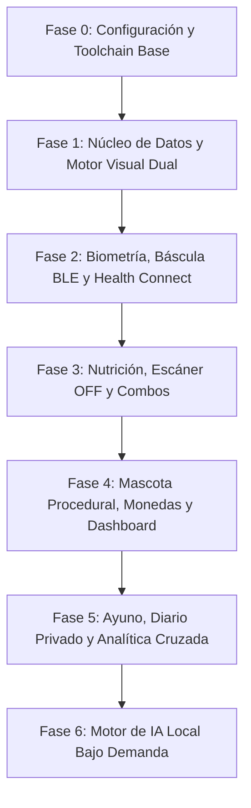

# 11 · Plan de Ejecución Modular y Roadmap (`docs/11_ROADMAP.md`)

> **Contexto Técnico:** Roadmap estricto de desarrollo para implementar **NB Selfcare** de forma modular, incremental y verificable sin errores de compilación ni dependencias fantasma.

---

## 1. Visión General de las Fases de Desarrollo

---

## 2. Detalle de Fases de Ejecución

### Fase 0: Toolchain y Configuración del Proyecto (Completada)
* [x] Creación de `.gitignore`, `.gitattributes`, `.editorconfig` y `.fvmrc`.
* [x] Configuración de `pubspec.yaml` con versiones estables verificadas (Flutter 3.47+ / Dart 3.13+).
* [x] Configuración de reglas estrictas en `analysis_options.yaml` (`strict-casts`, `strict-inference`).
* [x] Configuración de generadores en `build.yaml` (`store_date_time_values_as_text: true`).
* [x] Configuración de internacionalización `l10n.yaml` y plantilla base `app_es.arb`.

### Fase 1: Núcleo de Persistencia Drift, Semilla y Temas Duales (Completada)
* [x] Crear `lib/core/database/tables.dart` con las 14 tablas relacionales.
* [x] Crear `lib/core/database/app_database.dart` con soporte de triggers `FTS5`, PRAGMA WAL y método `VACUUM INTO`.
* [x] Implementar `DatabaseSeeder` para poblar en el primer arranque el catálogo base de alimentos en español (USDA) con el triángulo de electrolitos y el estado inicial de la mascota.
* [x] Implementar `lib/core/theme/app_theme.dart` (Material You) y `lib/core/theme/nxtpaper_eink_theme.dart` (Modo Papel E-Ink sin sombras ni elevación con bordes 1.5px).
* [x] Construir `OnboardingScreen` para configurar el perfil inicial (`UserProfiles`) y seleccionar el modo de visualización.

### Fase 2: Laboratorio Corporal, Báscula BLE y Health Connect (Completada)
* [x] Crear `BodyScaleDriver` (interfaz abstracta) y `XiaomiMiScale2Driver` (escaneo pasivo BLE `0x181B` y decodificación de 13 bytes).
* [x] Implementar `BiometricFormulas`: derivación de las 13 métricas, edad al vuelo, Katch-McArdle, Peso Tendencia (EMA $\alpha = 0.1$), Detector de Retención Hídrica, Ecuación US Navy quincenal y calibrador de TDEE Adaptativo (14 días).
* [x] Implementar `HealthConnectService` para sincronización bidireccional en Android 16 (sueño, pasos, ritmo cardíaco, peso, grasa e hidratación).
* [x] Construir `BodyAndWorkoutScreen`: pesaje en vivo con animación de báscula, gráfica dual de peso bruto vs. EMA, banner de falsa subida y selector de bloques RPE en 5 segundos.

### Fase 3: Motor de Nutrición, Escáner EAN-13 y Combos (Completada)
* [x] Construir `NutritionScreen` con anillos dinámicos y semáforo de electrolitos (Na, K, Mg, Fibra, Hierro, Calcio, Vitaminas).
* [x] Integrar `BarcodeScannerModal` con búsqueda en caché SQLite local y consulta asíncrona a Open Food Facts.
* [x] Implementar `MealCombosWidget` con barra deslizadora de porción ($0.25\times\text{–}3.0\times$) y botón de *"Repetir comida de ayer"*.
* [x] Implementar registro rápido de vasos de agua (`+250 ml`, `+500 ml`).

### Fase 4: Mascota Virtual Procedural, Economía Positiva y Dashboard
* [ ] Construir `ProceduralPetCanvas` en `CustomPainter` (60 fps, reactivo a cetosis, agua, sueño, pesaje BLE y accesorios).
* [ ] Implementar `CoinLedgerService` con idempotencia diaria, multiplicador $1.5\times$ por sueño reparador, Escudos de Racha y tienda de recompensas.
* [ ] Ensamblar `DashboardScreen` unificando el hábitat de la mascota, anillos de calorías, Bento Grid de estado en vivo y Dock de acciones en 1 toque.

### Fase 5: Ayuno Intermitente, Diario Privado y Analítica Cruzada
* [ ] Construir `FastingAndAlarmsScreen` con cronómetro metabólico nativo en pantalla de bloqueo (`Chronometer` del sistema) y alarmas exactas.
* [ ] Construir `JournalAnalyticsProfileScreen`: editor de diario privado con soporte de fotos locales y motor estadístico de correlaciones cruzadas (sueño, estrés, ayuno y peso).
* [ ] Panel de ajustes del perfil vivo y exportación/importación atómica de `nb_selfcare.sqlite`.

### Fase 6: Motor de IA Local Bajo Demanda (`LocalAiService`)
* [ ] Implementar el gestor de ciclo de vida del modelo local (`.task` / `.litertlm` / `.gguf`) con carga perezosa (Lazy-Loading) y liberación automática de RAM a los $120\text{ s}$ de inactividad.
* [ ] Conectar dictado de comidas en lenguaje natural con gramática JSON y cruce en `food_items_fts`.
* [ ] Conectar análisis de sentimiento del diario y generación de saludo empático de la mascota con fallback determinista.

