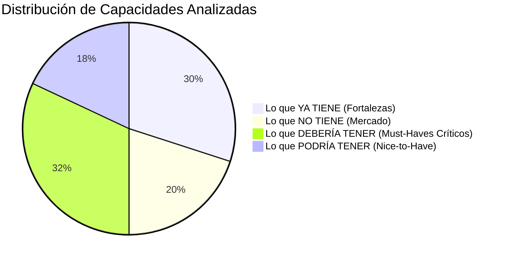
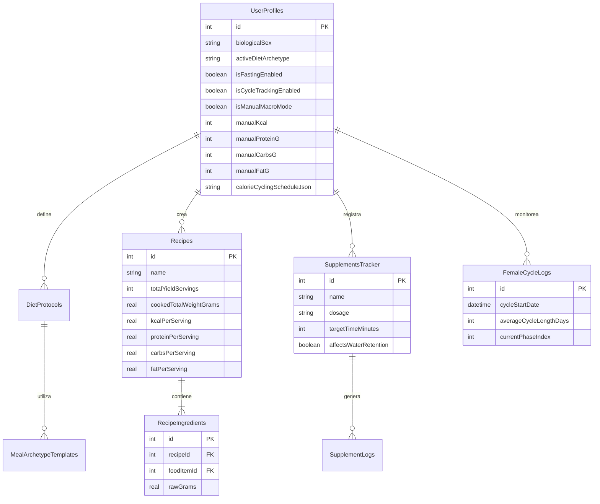

# 13 · Análisis Competitivo de Mercado, Brechas de Valor y Modos Inteligentes (`docs/13_COMPETITIVE_ANALYSIS_AND_VALUE_GAPS.md`)

> **Contexto Estratégico:** Evaluación comparativa profunda de **NB Selfcare** (`com.nb.selfcare`) frente al mercado de aplicaciones de salud globales (grandes ecosistemas, apps medianas especializadas y apps de nicho boutique).
> 
> **Premisa de Evaluación:** No se evalúa la conexión a hardware adicional (relojes, pulseras o básculas de terceros) ni la captura nativa de pasos/sueño (ambas cubiertas por diseño mediante Health Connect y Xiaomi Mi Scale 2). Se evalúa **el valor intrínseco, la utilidad fisiológica real, la psicología del comportamiento, la inteligencia nutricional, la reducción de fatiga de decisión y la experiencia de autocuidado personal.**

---

## 1. Resumen Ejecutivo y Diagnóstico de Posicionamiento

NB Selfcare nace con una propuesta de valor disruptiva y radicalmente honesta: **un santuario de autocuidado 100% offline, monousuario, sin suscripciones, sin nube, sin telemetría y optimizado para pantallas de tinta electrónica / NXTPAPER y Material You.**

Al consolidar en un solo binario local capacidades que el mercado comercial cobra a razón de \$50 a \$120 USD al año mediante suscripciones fragmentadas (MyFitnessPal Premium, MacroFactor, Cronometer Gold, Zero Fasting y Zepp Life), la aplicación ya se sitúa en un percentil técnico altísimo.

```mermaid
flowchart TD
    subgraph Mercado Actual (Fragmentado y de Pago)
        MF["MacroFactor ($72/año)<br>TDEE Adaptativo + EMA"]
        CR["Cronometer Gold ($55/año)<br>Micronutrientes + Electrolitos"]
        ZF["Zero Fasting ($70/año)<br>Fases Metabólicas"]
        ZL["Zepp Life (Privativa/Ads)<br>13 Métricas BLE"]
        DY["Bearable / Daylio ($35/año)<br>Diario + Correlaciones"]
    end

    subgraph NB Selfcare (Santuario Local)
        NB["NB Selfcare (100% Offline, SQLite, IA Local, Fusión BIA+Navy, Nibi)"]
    end

    MF -.->|Consolidado| NB
    CR -.->|Consolidado| NB
    ZF -.->|Consolidado| NB
    ZL -.->|Consolidado| NB
    DY -.->|Consolidado| NB
```

### El Diagnóstico Crítico: ¿Dónde está el límite hoy?
Aunque la base técnica es sólida y cumple con los documentos `docs/01` al `docs/12`, el análisis frente al mercado revela dos grandes desajustes que impiden que el producto alcance su potencial definitivo:

1. **La brecha entre la teoría matemática y la vida real:** La aplicación trata la nutrición y el peso como ecuaciones lineales estáticas, cuando la biología humana es **cíclica, adaptativa, hormonal y social**. Faltan herramientas cotidianas: cocinar una olla para varios días, salir a cenar un sábado sin arruinar la semana, evitar el estancamiento metabólico, dosificar con seguridad los ayunos y adaptar la interfaz al perfil del usuario (ej. eliminar menciones del ciclo menstrual en hombres).
2. **Fatiga de decisión vs. Orientación activa:** Hasta ahora, la app es un **registrador pasivo de alta precisión**. Te dice cuánto has comido o cuánto pesas, pero no te ayuda a planear tu semana ni te dice *"qué comer hoy para dar en el clavo con tus metas sin matarte la cabeza"*.

---

## 2. Benchmark Competitivo Detallado por Aplicación

A continuación se analiza el mercado agrupado por segmentos, identificando la "Feature Estrella" que retiene a sus usuarios y su comparación directa con lo que hoy ofrece NB Selfcare.

| Segmento | Aplicación | Enfoque Principal | Feature Estrella / Valor Diferencial | Brecha Frente a NB Selfcare |
| :--- | :--- | :--- | :--- | :--- |
| **Grandes Ecosistemas** | **Samsung Health** | Salud integral, hardware y estilo de vida | • Seguimiento de medicación y suplementos con horarios y adherencia.<br>• Salud femenina contextual (solo en perfil mujer).<br>• Alertas de sedentarismo prolongado.<br>• Resumen clínico exportable. | NB Selfcare no tiene seguimiento de suplementos/fármacos, no contempla el ciclo femenino ni emite informes clínicos para médicos. |
| | **Apple Health** | Centralización médica y biométrica | • Registro de estado de ánimo puntual vs. diario.<br>• Historial de medicaciones con alertas de interacción.<br>• Tendencias de variabilidad cardíaca (HRV) y recuperación. | Health Connect cubre la lectura de sueño/pasos, pero NB Selfcare carece de un sistema de registro de medicamentos y síntomas. |
| | **Google Fit / Health Connect** | Movimiento y actividad base | • Puntos Cardio (OMS).<br>• Centralización de datos de sensores pasivos. | NB Selfcare ya aprovecha Health Connect como puente, superando a Google Fit en analítica nutricional y composición corporal. |
| **Especializadas en Nutrición** | **MacroFactor** | Nutrición científica basada en adherencia | • **Filosofía de Adherencia Neutral:** Cero culpabilidad, cero barras rojas.<br>• **Periodización de la Dieta:** Déficit, Mantenimiento, Volumen y *Diet Breaks*.<br>• **Calorie Cycling:** Presupuesto calórico semanal (días altos/bajos).<br>• **Modo Coached vs. Manual:** Control total de macros para prescripción médica/deportiva. | El TDEE adaptativo de NB Selfcare emula a MacroFactor, pero no tiene fases de dieta, modo manual de macros ni distribución semanal flexible. |
| | **Cronometer (Gold)** | Máximo rigor en micronutrientes | • **Límites Máximos Tolerables (UL):** Alertas de toxicidad en vitaminas/minerales.<br>• **Nutrient Oracle:** Recomienda alimentos específicos para cubrir lo que falta hoy.<br>• Biomarcadores de laboratorio personalizados. | NB Selfcare tiene el triángulo de electrolitos (Na/K/Mg), pero carece de límites superiores de toxicidad y no sugiere qué comer para cerrar los déficits del día. |
| | **MyFitnessPal** | Base de datos masiva y comidas | • **Catálogo masivo de códigos de barras comunitarios.**<br>• **Creador de Recetas Multiración:** Cocinar porciones familiares y guardar 1 ración.<br>• Importador de recetas desde URLs. | NB Selfcare tiene una base local limitada en productos de cocina comercial y carece de un creador de recetas familiares por porciones. |
| | **Fitia** | Planificación de comidas y dietas | • **Recomendador de platos según arquetipo de dieta (Keto, Mediterránea, etc.).**<br>• Porciones calculadas automáticamente para clavar las calorías del día.<br>• Lista de compras semanal consolidada. | NB Selfcare no recomienda menús completos según estilo de dieta ni tiene un planificador semanal integrado. |
| **Ayuno y Hábitos** | **Zero Fasting / Simple** | Ayuno intermitente y autofagia | • **Dosificación y pautas seguras de ayuno (evitar abusos de OMAD).**<br>• **Protocolo para romper el ayuno:** Guía de re-alimentación para evitar malestar digestivo.<br>• Ayunos circadianos. | NB Selfcare tiene cronómetro persistente, pero no alerta sobre la frecuencia máxima segura de ayunos agresivos ni guía sobre cómo romperlos. |
| **Composición Corporal** | **Zepp Life / Mi Fitness** | Ecosistema Xiaomi Mi Scale | • Las 13 métricas de bioimpedancia.<br>• Puntuación corporal e historial. | **NB Selfcare ya supera a Zepp Life:** Lee los 13 bytes directamente por BLE sin publicidad, sin nube china, y añade la validación US Navy con detector de retención hídrica. |
| | **Happy Scale / Libra** | Psicología de la báscula | • **Mini-Hitos Psicológicos:** Dividir 15 kg en metas de 1.5 kg.<br>• Bandas de predicción temporal (fecha de llegada optimista/conservadora). | NB Selfcare calcula la EMA, pero muestra el objetivo final lejano sin segmentarlo en hitos psicológicos intermedios ni predecir la fecha estimada de llegada. |
| **Salud y Síntomas** | **Bearable / Daylio** | Correlación de salud y síntomas | • Registro de salud digestiva (Escala de Bristol 1–7).<br>• Curva de decaimiento de cafeína.<br>• Correlación entre alimentos/estrés y síntomas. | El diario de NB Selfcare registra ánimo/energía/estrés, pero no contempla síntomas gastrointestinales ni farmacocinética de cafeína. |
| | **Yuka** | Calidad alimentaria y aditivos | • Clasificación NOVA (grados de ultraprocesamiento).<br>• Detección de aditivos nocivos y alternativas saludables. | NB Selfcare usa Open Food Facts y Nutri-Score, pero no categoriza el grado de ultraprocesamiento (NOVA 1 a 4). |

---

## 3. Matriz Exhaustiva de Capacidades (Las 4 Listas)



---

### LISTA 1 · Lo que YA TIENE (Fortalezas y Diferenciadores Únicos)

1. **Santuario 100% Offline-First y Cero Telemetría:** Sin cuentas, sin Firebase, sin SDKs espías, base SQLite local pura con exportación atómica `VACUUM INTO`.
2. **Driver BLE Directo Xiaomi Mi Body Composition Scale 2:** Interceptación pasiva del paquete publicitario `0x181B` (13 bytes) en tiempo real, sin abrir Zepp Life ni vincular la báscula al sistema operativo.
3. **Derivación Local de las 13 Métricas Biométricas:** Peso, IMC, % Grasa, Masa Muscular, Agua, Grasa Visceral, Hueso, Proteína, BMR Katch-McArdle, Edad Metabólica, Masa Magra, Puntaje Corporal y Somatotipo.
4. **Fusión BIA + Ecuación US Navy Quincenal:** Ponderación 60% bioimpedancia + 40% cinta métrica (cintura, cuello, cadera) para neutralizar los errores de hidratación del sensor de pies.
5. **Peso Tendencia (EMA $\alpha = 0.1$):** Suavizado exponencial matemático idéntico a MacroFactor y Happy Scale para ignorar el ruido diario del agua corporal.
6. **Detector Heurístico de "Falsa Subida" (Retención Hídrica):** Algoritmo que analiza picos de sodio (> 2500 mg), supercompensación de glucógeno ($> 1.3\times$ carbohidratos habituales) y salto de agua por BIA para tranquilizar al usuario con una explicación biológica.
7. **TDEE Adaptativo por Ventana Móvil de 14 Días:** Recalibración del gasto energético real basada en el balance calórico y la variación de peso tendencia ($\Delta\text{EMA}_{14\text{d}} \times 7700\text{ kcal/kg}$), con amortiguador de seguridad de $\pm 150\text{ kcal/sem}$.
8. **Motor de IA Local con Ciclo de Vida de GPU (120s TTL):** Inferencia on-device (Qwen / Gemma en LiteRT/gguf) para estructuración de comidas y análisis de diario, con auto-descarga de RAM para no saturar el dispositivo.
9. **Degradación Determinista Completa:** Si no hay modelo de IA cargado, la app opera al 100% mediante diccionarios, regex, selectores manuales y bancos de frases.
10. **Triángulo Electrolítico (Sodio, Potasio, Magnesio):** Foco en minerales de rendimiento y cetosis, complementado con Fibra, Calcio, Hierro, Zinc y Vitaminas clave.
11. **Principio de Honestidad de Datos:** Distinción clara en la interfaz entre "0 mg declarados" y "Dato no reportado" para no inducir pánico por falta de datos en etiquetas industriales.
12. **Combos Caseros con Escalador Continuo (0.25x – 3.0x):** Multiplicador táctil para registrar combinaciones frecuentes de alimentos en 2 toques.
13. **"Repetir Comida de Ayer" con Deshacer:** Registro en 1 toque por franja horaria (`breakfast`, `lunch`, `dinner`, `snack`).
14. **Escáner EAN-13 Híbrido:** Caché local ultra-rápida FTS5 + consulta a Open Food Facts + alta manual offline de 4 datos.
15. **Bloques de Ejercicio RPE en 5 Segundos:** Gasto calórico neto por METs descontando el reposo basal y usando el último peso real de la báscula, sin registrar series individuales.
16. **Cronómetro de Ayuno de Cero Consumo de CPU:** Uso de `setUsesChronometer(true)` en la barra de estado y pantalla de bloqueo; en Android 16 se promueve a Live Update.
17. **Línea de Tiempo Metabólica Fisiológica:** Transiciones automáticas entre fases: Anabólica, Glucogenólisis, Lipólisis/Aura cetogénica, Cetosis y Autofagia profunda.
18. **Mascota Procedural `Nibi` (`CustomPainter`):** Gráficos vectoriales sin dependencias de assets pesados, reactivos a la hidratación, cetosis, horas de sueño y pesaje en vivo.
19. **Economía Positiva (`CoinLedger`) y Escudos de Racha:** Cero punición (la mascota no muere ni enferma); multiplicador $1.5\times$ por sueño reparador y escudos para vacaciones.
20. **Motor Visual Dual:** Material You dinámico + Modo Papel NXTPAPER E-Ink (elevación cero, bordes sólidos de 1.5 px, sin sombras ni estelas en gráficas).
21. **Motor de Correlaciones Estadísticas (Pearson $r$):** Hallazgos cruzados locales entre sueño, estrés, calorías consumidas y peso tendencia.

---

### LISTA 2 · Lo que NO TIENE (Ausencias Respecto al Mercado)

1. **Modos Contextuales Dinámicos:** La interfaz muestra módulos universales sin adaptarse al perfil (ej. elementos de salud femenina visibles en hombres o funciones avanzadas activas cuando se busca simplicidad).
2. **Arquetipos de Dieta y Menús Recomendados:** No ofrece selección de estilo alimentario (Mediterránea, Keto, Alta en Proteína, Vegana) ni sugiere platos completos calculados para cumplir macros y micros.
3. **Pauta y Dosificación Segura del Ayuno:** No limita ni advierte sobre la frecuencia máxima recomendada de protocolos agresivos como OMAD 23:1 (riesgo de desnutrición o daño metabólico si se hace a diario).
4. **Tablero de Planificación Proactiva ("Mi Protocolo Semanal"):** La app solo tiene el "peso meta"; carece de una vista donde planear ayunos, suplementos, dieta y entrenamientos de la semana.
5. **Control de Sobrescritura Manual de Metas:** El TDEE adaptativo es obligatorio; no permite que el usuario fije sus calorías y ratios de macronutrientes manualmente por prescripción médica o decisión deportiva.
6. **Descontaminación Cognitiva en la Vista Principal:** Exceso de fórmulas matemáticas, siglas y términos técnicos en las pantallas cotidianas en lugar de una interfaz orientada exclusivamente a la acción.
7. **Catálogo Masivo Offline de Códigos de Barras:** La base de datos local es reducida frente a la despensa real del usuario (muchos códigos cotidianos no se reconocen).
8. **Gestor de Recetas Caseras Multiración (Batch Cooking):** Imposibilidad de registrar los ingredientes de una preparación entera familiar y computar porciones individuales.
9. **Periodización de la Dieta (Fases Metabólicas):** No existen modos de *Mantenimiento*, *Diet Breaks* ni *Reverse Dieting*.
10. **Distribución Flexible Semanal de Calorías (Calorie Cycling):** Las calorías son rígidas de lunes a domingo sin permitir guardar margen para el fin de semana.
11. **Rastreador de Suplementos y Medicación:** Cero registro de creatina, magnesio o fármacos con impacto biométrico.
12. **Límites Máximos Tolerables de Micronutrientes (UL):** No alerta si el usuario supera límites seguros de toxicidad en minerales o vitaminas.
13. **Protocolo Guiado para Romper el Ayuno:** Falta orientación sobre re-alimentación tras ayunos largos para evitar distensión o choque insulínico.
14. **Exportación de Informe Clínico para Médicos en PDF:** No genera documentos formales para profesionales de la salud.

---

### LISTA 3 · Lo que DEBERÍA TENER (Prioridad Alta / Valor Crítico — "Must-Haves")

> [!IMPORTANT]
> Estas características transforman a NB Selfcare de un registrador matemático pasivo a un **compañero de vida proactivo, inteligente y sin fricción**, manteniendo el rigor 100% offline.

```mermaid
flowchart TD
    subgraph Experiencia de Usuario Adaptada
        M1["1. Modos Contextuales Dinámicos<br>(UI limpia según sexo biológico y foco)"]
        M6["6. Descontaminación Cognitiva<br>(Action-First, Science-on-Demand)"]
    end

    subgraph Inteligencia y Planificación Proactiva
        M4["4. Tablero de Planificación 'Mi Protocolo'<br>(Semana de ayuno, suplementos, entreno)"]
        M2["2. Arquetipos de Dieta y Menús Sugeridos<br>(Mediterránea, Keto, Fit, Vegana vs Libre)"]
        M3["3. Dosificación Segura de Ayuno<br>(Límites a OMAD, realimentación protegida)"]
        M5["5. Control Manual de Metas y Macros<br>(Sobrescritura médica o culturismo)"]
    end

    subgraph Fisiología y Nutrición Real
        M7["7. Catálogo Masivo Offline + OCR<br>(Seed regional Open Food Facts + Escáner)"]
        M8["8. Recetas Multiración Batch Cooking"]
        M9["9. Periodización y Calorie Cycling"]
        M10["10. Salud Femenina, Suplementos y PDF Clínico"]
    end

    Experiencia de Usuario Adaptada --> Inteligencia y Planificación Proactiva
    Inteligencia y Planificación Proactiva --> Fisiología y Nutrición Real
```

#### 1. Modos Contextuales Dinámicos (Zero Ruido Cognitivo)
* **Principio de Interfaz Limpia:** Si el perfil es masculino (`biologicalSex == 'male'`), todo elemento referente al ciclo menstrual, ovulación y fase lútea desaparece completamente de la UI, menús y analíticas. Si es femenino, se integra orgánicamente en el laboratorio corporal y nutrición.
* **Modos de Enfoque:** Si el usuario desactiva el ayuno intermitente porque no lo practica, la pestaña o accesos directos de ayuno se repliegan para dejar espacio al entrenamiento y nutrición. La app se adapta a la persona, no la persona a la app.

#### 2. Arquetipos de Dieta y Recomendador Inteligente de Menús Diarios
* **El Problema:** La gente abandona las apps de nutrición por la **fatiga de decisión**: tener que pensar cada comida, calcular gramos y cuadrar números a mano.
* **La Solución:**
  * Selector de Estilo Alimentario:
    1. **Dieta Mediterránea** (prioriza aceite de oliva virgen, pescados, legumbres, vegetales y frutos secos).
    2. **Cetogénica / Low-Carb** (alta en grasas saludables, moderada en proteína, carbohidratos netos $< 30\text{–}50\text{ g}$).
    3. **Fitness / Hipertrofia** (alta en proteína $1.8\text{–}2.2\text{ g/kg}$, carbohidratos complejos para rendimiento).
    4. **Basada en Plantas** (vegana/vegetariana con supervisión de B12, hierro y combinaciones de aminoácidos).
    5. **Equilibrada Estándar**.
    6. **Modo Libre / Personalizado:** Para quienes prefieren registrar a su antojo sin sugerencias.
  * **Motor de Porciones Exactas:** Si el usuario elige un estilo, al abrir el día la app puede sugerir un menú del día estructurado (Desayuno, Almuerzo, Cena, Snack) con ingredientes del catálogo local cuyas porciones están calculadas matemáticamente para dar **en el clavo** con las calorías, macros y electrolitos del día en un solo toque.

#### 3. Pauta y Dosificación Fisiológica Segura del Ayuno
* **El Problema:** Usuarios principiantes leen sobre "autofagia y células madre" en ayunos como OMAD 23:1 y cometen el error peligroso de hacerlo los 7 días de la semana, desencadenando pérdida de masa muscular, amenorrea hipotalámica en mujeres o enlentecimiento tiroideo.
* **La Solución:**
  * **Prescripción Basada en Evidencia:**
    * Protocolos diarios sostenibles: `14:10` y `16:8` (sin límite de días consecutivos).
    * Protocolos agresivos (`20:4`, `OMAD 23:1`, `> 24 h`): La app advierte que deben usarse de 1 a 2 veces por semana como máximo, exige días intermedios de alimentación normal y bloquea el inicio de un segundo OMAD consecutivo salvo confirmación consciente del usuario con advertencia médica.
  * **Protocolo de Re-alimentación:** Al detener un ayuno $\ge 18\text{ h}$, la app sugiere alimentos de transición para los primeros 30 minutos (caldo de huesos, aguacate, proteínas blandas) para evitar picos de insulina y diarrea osmótica.

#### 4. Tablero de Planificación Integral ("Mi Protocolo Semanal")
* **El Problema:** La app actualmente solo mira un objetivo: "peso meta". El usuario no tiene dónde orquestar su estrategia semanal.
* **La Solución — Nueva Vista `/protocol` o Tablero Semanal:**
  * Un panel donde se visualiza el plan de acción:
    * **Pauta de Ayuno:** Qué días se ayuna y qué protocolo (ej. 16:8 de Lunes a Jueves, OMAD el Viernes, descanso Sábado y Domingo).
    * **Estilo de Dieta:** Arquetipo activo o modo libre.
    * **Pauta de Suplementos / Fármacos:** Creatina (5g con almuerzo), Magnesio (300mg noche), Medicación matutina (dispara recordatorios automáticos).
    * **Entrenamiento:** Días y franjas planeadas de ejercicio (permite anticipar el gasto en el balance).
  * **Asistente de la IA Local:** Un diálogo guiado donde el usuario dice *"Quiero definir mi protocolo para definir músculo sin perder fuerza"* y la IA sugiere un protocolo balanceado para aprobación en 1 toque.

#### 5. Control Manual de Metas y Macronutrientes (Modo Personalizado / Médico)
* **El Problema:** El TDEE adaptativo automático es brillante, pero restrictivo si el usuario tiene una indicación clínica (ej. un nefrólogo que ordena limitar proteína a $0.8\text{ g/kg}$, un endocrinólogo que prescribe restricción severa de carbohidratos, o un atleta que busca un superávit hipercalórico específico).
* **La Solución:**
  * Selector de Modo en el Perfil:
    * **Modo Adaptativo Inteligente (Recomendado):** El motor recalibra calorías y macros automáticamente según la báscula y el balance de 14 días.
    * **Modo Manual / Prescripción Médica:** El usuario fija manualmente sus calorías diarias, gramos o porcentajes de proteína, carbohidratos y grasa, congelando el recálculo automático.

#### 6. Descontaminación Cognitiva y Progresión Informativa ("Action-First, Science-on-Demand")
* **El Problema:** Pantallas saturadas con siglas como METs netos, fórmulas de Katch-McArdle, coeficientes alfa de EMA o factores de BIA abruman al usuario común.
* **La Solución:**
  * **Capa 1 (Vista General Cotidiana):** Enfocada exclusivamente en la acción y el estado: *"Te quedan 450 kcal"*, *"Hidratación al 70%"*, *"Ayuno en fase de quema de grasa"*, *"Peso tendencia: -300g esta semana"*. Sin fórmulas ni jerga matemática.
  * **Capa 2 (Ciencia Bajo Demanda):** Al tocar cualquier tarjeta (como ya se hace en Composición Corporal), se abre una hoja educativa elegante explicando la fisiología, la fórmula aplicada y la bibliografía de referencia para quienes desean aprender.

#### 7. Estrategia de Catálogo Masivo: Integración Maestra de Open Food Facts (Nivel MyFitnessPal)
* **El Problema Real:** El usuario escanea productos reales en su cocina y nota que la base de datos se siente limitada frente a gigantes comerciales como MyFitnessPal. Aunque el volcado completo de MongoDB de Open Food Facts pesa más de 15 GB (inviable e innecesario para un teléfono móvil), la API pública y gratuita de Open Food Facts alberga más de 3 millones de productos mundiales.
* **Alineación con la Privacidad (Cero Telemetría):** Consultar un código de barras (`GET /api/v2/product/{barcode}.json`) o un término de búsqueda (`GET /cgi/search.pl?search_terms=...`) es una petición de lectura anónima que **no envía ningún dato personal, ni correo, ni ubicación, ni biométricos**. Cumple al 100% el guardrail de `AGENTS.md` §1.1.
* **La Arquitectura Maestra de 4 Pasos (Nivel MyFitnessPal sin Suscripción):**
  1. **Caché Persistente Local en SQLite (FTS5):** Cada vez que un producto se resuelve por la API, se normaliza inmediatamente a 100 g (macros, micronutrientes, Nutri-Score, NOVA, marca) y se inserta en `food_items` local. El dispositivo "aprende" la despensa del usuario para siempre; la segunda vez que se escanea o busca, la respuesta tarda $< 30\text{ ms}$ sin conexión a internet.
  2. **Búsqueda Híbrida en Dos Niveles (Texto y Escáner):**
     * En el escáner de código de barras: busca primero en local; si no está, consulta la API de OFF con timeout adaptativo y normalización de ceros iniciales (UPC-A vs. EAN-13).
     * En la barra de búsqueda por texto: busca instantáneamente en la base local con FTS5. Si hay pocos resultados o el usuario lo solicita, un botón rápido *"Buscar en Open Food Facts"* consulta la API pública en tiempo real y permite importar el alimento con 1 toque al catálogo del dispositivo.
  3. **Escáner Inteligente con OCR Local de Tabla Nutricional (El salvavidas para el 1% restante):** Si un producto artesanal, panadería local o marca hiperlocal no existe en Open Food Facts, el usuario no tiene que teclear a mano. Apunta la cámara a la **tabla nutricional del empaque** y la librería local de OCR (ML Kit on-device) lee calorías, proteínas, carbohidratos y grasas en 1 segundo, asociándolo a ese código de barras en el teléfono.
  4. **Semilla Base Pre-empaquetada en Español:** El instalador incluye la semilla USDA en español latinoamericano (carnes, huevos, frutas, cereales, legumbres) para que la experiencia sea rica y operativa desde el segundo cero, sin depender de descargas iniciales masivas.

#### 8. Gestor de Recetas Caseras Multiración (*Batch Cooking & Yields*)
* Introducción de ingredientes crudos totales de una preparación familiar.
* Definición del rendimiento: por **Número de Raciones** (ej. 4 platos) o por **Peso Final Cocinado** (ej. 1,400 g totales, 350 g servidos).
* Registro de 1 porción en 1 toque.

#### 9. Distribución Semanal Flexible de Calorías (*Calorie Cycling & Weekend Banking*)
* Programación de días altos y bajos dentro de la misma semana manteniendo el promedio del TDEE adaptativo.
* Banco de calorías semanal para disfrutar de vida social sin salirse del plan ni sentir culpa.

#### 10. Periodización Metabólica (*Fases de Dieta & Diet Breaks*)
* Modos de *Pérdida de Grasa*, *Mantenimiento* (clave para consolidar) y *Diet Breaks* (1–2 semanas en normocalórica para resetear leptina y tiroides).
* Salida guiada mediante *Reverse Dieting* (+75 kcal/semana) para evitar el rebote.

#### 11. Rastreador de Suplementación y Fármacos Clave
* Registro diario rápido de creatina (amortiguando falsas alarmas de peso en agua), magnesio, electrolitos y medicación crónica.

#### 12. Límites Máximos Tolerables de Micronutrientes (*Tolerable Upper Intake Levels — UL*)
* Techos de seguridad en el semáforo para evitar toxicidad de sodio, potasio, magnesio suplementado, zinc y vitamina D.

#### 13. Exportación de Informe Clínico para Médicos en PDF
* Resumen médico formal de 1–2 páginas A4 generado localmente con gráficas de presión, sueño, peso tendencia, BIA y balance electrolítico.

---

### LISTA 4 · Lo que PODRÍA TENER (Prioridad Media/Baja — "Nice-to-Have")

1. **Curva Circadiana de Decaimiento de la Cafeína:** Farmacocinética de vida media (5–7 h) con proyección de cafeína residual a la hora de dormir y recomendación de hora de corte.
2. **Escala de Heces de Bristol y Síntomas Digestivos:** Registro de digestión (tipos 1 a 7) y cruce con alimentos registrados para detectar sensibilidades (lácteos, gluten, polioles).
3. **Puntuación NOVA de Ultraprocesados:** Indicador del porcentaje calórico proveniente de ultraprocesados (Grupo 4) vs. comida real (Grupo 1).
4. **Mini-Hitos Psicológicos con Proyecciones (Happy Scale):** Subdivisión del objetivo en etapas de 1.5 kg con fechas estimadas optimista, realista y conservadora.
5. **Check-In Dominical Ceremonial:** Revisión semanal interactiva con la mascota `Nibi` los domingos para evaluar adherencia y proponer ajustes.
6. **Índice de Disponibilidad Fisiológica (*Readiness Score*):** Puntuación de recuperación cruzando sueño de Health Connect, frecuencia cardíaca en reposo y RPE previo.
7. **Pomodoro de Sedentarismo:** Alertas discretas tras 60–90 minutos continuos sin pasos detectados.

---

## 4. Arquitectura de Datos del Planificador y Modos Contextuales

Para soportar las nuevas capacidades sin vulnerar el principio 100% offline-first ni añadir telemetría, se define el esquema de tablas complementarias en SQLite:



---

## 5. Tabla Comparativa de Cobertura Global

| Funcionalidad / Módulo | MyFitnessPal | MacroFactor | Cronometer | Fitia | Zero Fasting | **NB Selfcare (Hoy)** | **NB Selfcare (Con Nuevos Modos)** |
| :--- | :---: | :---: | :---: | :---: | :---: | :---: | :---: |
| **100% Offline y Cero Nube** | ❌ | ❌ | ❌ | ❌ | ❌ | ✅ | ✅ |
| **Báscula BLE 13 Métricas Directas** | ❌ | ❌ | ❌ | ❌ | ❌ | ✅ | ✅ |
| **Fusión BIA + Cinta US Navy** | ❌ | ❌ | ❌ | ❌ | ❌ | ✅ | ✅ |
| **TDEE Adaptativo Dinámico** | ❌ | ✅ | ❌ | ❌ | ❌ | ✅ | ✅ |
| **Modos Contextuales (Sin ruido por sexo)** | ❌ | ❌ | ❌ | ❌ | ❌ | ❌ | ✅ |
| **Arquetipos de Dieta y Menús Sugeridos** | ❌ | ❌ | ❌ | ✅ | ❌ | ❌ | ✅ |
| **Pauta y Dosificación Segura de Ayuno** | ❌ | ❌ | ❌ | ❌ | ✅ | ❌ | ✅ |
| **Tablero Integral 'Mi Protocolo'** | ❌ | ❌ | ❌ | ❌ | ❌ | ❌ | ✅ |
| **Control Manual de Metas (Modo Médico)** | ✅ | ✅ | ✅ | ❌ | ❌ | ❌ | ✅ |
| **Descontaminación Cognitiva (Action-First)** | ❌ | ❌ | ❌ | ❌ | ❌ | Parcial | ✅ |
| **OCR Local de Tabla Nutricional** | ❌ | ❌ | ❌ | ❌ | ❌ | ❌ | ✅ |
| **Recetas Multiración (Batch Cooking)** | ✅ | ✅ | ✅ | ❌ | ❌ | ❌ | ✅ |
| **Presupuesto Semanal / Calorie Cycling** | ❌ | ✅ | ❌ | ❌ | ❌ | ❌ | ✅ |
| **Fases de Dieta / Diet Breaks** | ❌ | ✅ | ❌ | ❌ | ❌ | ❌ | ✅ |
| **Rastreador de Suplementos / Creatina** | ❌ | ❌ | ❌ | ❌ | ❌ | ❌ | ✅ |
| **Límites de Toxicidad (UL Micronutrientes)** | ❌ | ❌ | ✅ | ❌ | ❌ | ❌ | ✅ |
| **Exportación de Informe Clínico en PDF** | ❌ | ❌ | ✅ | ❌ | ❌ | ❌ | ✅ |
| **Modo E-Ink NXTPAPER (Anti-ghosting)** | ❌ | ❌ | ❌ | ❌ | ❌ | ✅ | ✅ |
| **IA Local en Dispositivo (Sin Nube)** | ❌ | ❌ | ❌ | ❌ | ❌ | ✅ | ✅ |

---

## 6. Plan de Implementación Estratégico

Para incorporar estos nuevos frentes de forma modular y sin saturar el desarrollo, se recomienda la siguiente secuencia de entrega:

### Fase A · Limpieza Cognitiva y Personalización Fina
1. **Modos Contextuales Dinámicos:** Ocultar condicionalmente ciclo femenino en perfil masculino y simplificar navegación si se desactivan módulos específicos.
2. **Descontaminación Visual de Pantallas Principales:** Mover fórmulas matemáticas y explicaciones de ingeniería a hojas modales de detalle pedagógico ("Aprende sobre esta métrica").
3. **Modo Manual / Médico de Metas:** Interruptor en el perfil para fijar calorías y macronutrientes fijos anulando la recalibración automática si se desea.

### Fase B · Inteligencia Nutricional y Despensa Real
1. **Creador de Recetas Caseras Multiración:** Ingredientes crudos + cálculo por raciones o peso cocinado.
2. **Integración Maestra Open Food Facts + OCR Local:** Búsqueda híbrida (código de barras y texto) con caché inmediata en SQLite (FTS5) + escáner OCR de tablas nutricionales on-device como respaldo.
3. **Arquetipos de Dieta y Menús Sugeridos:** Motor de plantillas (Mediterránea, Keto, Fit, Vegana, Libre) con porciones calculadas automáticamente para clavar las metas del día.

### Fase C · El Tablero de Protocolo y Seguridad Fisiológica
1. **Tablero Semanal "Mi Protocolo":** Vista unificada de estrategia (ayunos programados, dieta, entrenamientos, suplementos con recordatorios).
2. **Dosificación Segura de Ayunos Prolongados:** Límites y alertas a la repetición consecutiva de OMAD 23:1 + guía de re-alimentación.
3. **Periodización y Calorie Cycling:** Programación de días altos/bajos y fases de *Mantenimiento* / *Diet Breaks*.
4. **Exportador Clínico en PDF:** Generación local de informes de salud para profesionales.
