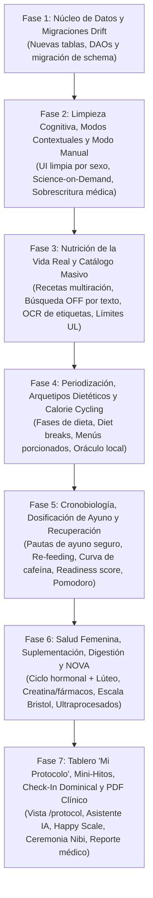

# 14 · Plan Maestro de Implementación Integral (`docs/14_MASTER_IMPLEMENTATION_PLAN.md`)

> **Contexto de Ejecución:** Hoja de ruta técnica pormenorizada para implementar el 100% de las capacidades ausentes, críticas y diferenciadoras identificadas en [`docs/13_COMPETITIVE_ANALYSIS_AND_VALUE_GAPS.md`](13_COMPETITIVE_ANALYSIS_AND_VALUE_GAPS.md).
> 
> **Garantía de Alcance:** Ningún punto de las Listas 2, 3 y 4 de Doc 13 queda por fuera. Todo se construye respetando los principios de [`AGENTS.md`](../AGENTS.md): **100% Offline-First, Cero Telemetría, Persistencia Reactiva Drift/SQLite, Compatibilidad Dual Material You + NXTPAPER E-Ink y Cero Placeholders.**

---

## 1. Mapa de Fases de Ejecución

---

## 2. Desglose Exhaustivo por Fase de Desarrollo

---

### FASE 1 · Núcleo de Persistencia Relacional y Migraciones Drift
* **Objetivo:** Preparar la base de datos `nb_selfcare.sqlite` con todas las tablas, columnas e índices necesarios para soportar las nuevas capacidades sin romper los datos existentes.

#### Tareas Técnicas Específicas:
1. **Actualizar `tables.dart` y `app_database.dart`:**
   * **Modificaciones a `UserProfiles`:**
     * `isCycleTrackingEnabled` (bool, default `false`).
     * `isFastingEnabled` (bool, default `true`).
     * `isManualMacroMode` (bool, default `false`).
     * `manualKcalTarget`, `manualProteinG`, `manualCarbsG`, `manualFatG` (int nullable).
     * `activeDietArchetype` (text, default `'flexible'`).
     * `activeDietPhase` (text, default `'deficit'` — `'deficit'`, `'maintenance'`, `'diet_break'`, `'reverse_diet'`).
     * `calorieCyclingScheduleJson` (text, default `"{}"`).
     * `caffeineBedtimeCutoffHours` (real, default `8.0`).
   * **Nuevas Tablas en Drift:**
     * `Recipes` & `RecipeIngredients`: Para preparación de recetas caseras multiración (rendimiento por porciones o peso cocinado).
     * `SupplementsTracker` & `SupplementLogs`: Fármacos y suplementos (dosis, hora de toma, afectación hídrica como creatina).
     * `FemaleCycleLogs`: Historial de menstruación, duración del ciclo, fase lútea y notas hormonales.
     * `DigestiveLogs`: Registro de salud intestinal con Escala de Bristol (1–7), síntomas digestivos y distensión.
     * `CaffeineLogs`: Ingestas de cafeína (mg, hora, fuente) para el cálculo farmacocinético.
     * `ProtocolPlans`: Configuración del tablero semanal de ayunos, dieta, suplementos y entrenamientos.
     * `MilestoneGoals`: Subdivisión de metas de peso en mini-hitos psicológicos de 1.5 kg.
2. **Estrategia de Migración de Drift (`MigrationStrategy`):**
   * Incrementar `schemaVersion` de 1 a 2.
   * En `onUpgrade`: ejecutar `m.createTable` para las nuevas tablas y `m.addColumn` para las nuevas columnas de `UserProfiles`.
   * Preservar íntegros los triggers `FTS5` de `food_items_fts`.
3. **Nuevos DAOs en `lib/core/database/daos/`:**
   * `RecipeDao`: CRUD de recetas con cálculo atómico de macros por ración.
   * `SupplementDao`: CRUD y registro diario de tomas con historial de adherencia.
   * `FemaleCycleDao`: Gestión del ciclo y cálculo de fase ovárica actual.
   * `DigestiveDao`: Consultas de síntomas y correlación con comidas.
   * `ProtocolDao`: Lectura y persistencia del plan semanal activo.

---

### FASE 2 · Limpieza Cognitiva, Modos Contextuales y Control Manual
* **Objetivo:** Eliminar la fatiga mental y jerga técnica de la interfaz, adaptar la UI al sexo del usuario y dar control manual total a quienes tengan prescripciones médicas o deportivas.

#### Tareas Técnicas Específicas:
1. **Modos Contextuales Dinámicos (Filtro por Perfil):**
   * Si `biologicalSex == 'male'`, el módulo de salud femenina se oculta al 100% en toda la aplicación (cero ruido cognitivo).
   * Si `isFastingEnabled == false`, la tab o accesos rápidos de ayuno se repliegan en la navegación.
2. **Descontaminación Visual ("Action-First, Science-on-Demand"):**
   * Rediseñar las tarjetas de la vista general del Dashboard, Nutrición y Cuerpo para mostrar únicamente métricas de acción (*"Te quedan 450 kcal"*, *"Hidratación al 70%"*, *"Tendencia: -300g"*).
   * Retirar fórmulas matemáticas explícitas (METs netos, Katch-McArdle, coeficientes alfa) del flujo primario.
   * Implementar `ScienceOnDemandSheet`: modal elegante y pedagógico que se abre al tocar cualquier métrica, explicando la fisiología, la fórmula y la bibliografía científica.
3. **Control Manual de Metas y Macronutrientes (Modo Médico / Personalizado):**
   * Panel en ajustes de perfil para activar *"Modo Manual / Prescripción Médica"*.
   * Selectores numéricos directos de Kcal, Proteínas, Carbohidratos y Grasas.
   * Congelamiento inmediato del recalibrador automático de TDEE cuando este modo esté activo.

---

### FASE 3 · Nutrición de la Vida Real y Catálogo Masivo (Nivel MyFitnessPal)
* **Objetivo:** Permitir registrar comida casera familiar sin esfuerzo y expandir la base de alimentos a nivel comercial sin romper el principio offline.

#### Tareas Técnicas Específicas:
1. **Gestor de Recetas Caseras Multiración (*Batch Cooking & Yields*):**
   * Pantalla y modal para crear una receta (`RecipeBuilderSheet`).
   * Selección de ingredientes crudos desde `food_items` con sus gramos.
   * Selector de Rendimiento:
     * **Modo Porciones:** *"Rinde 4 platos iguales"*.
     * **Modo Peso Cocinado:** *"Peso total de la olla: 1,350 g; mi porción servida: 320 g"*.
   * Cálculo automático exacto de calorías, macros y micronutrientes por ración.
   * Guardado permanente en la tabla `recipes` y registro en 1 toque en `food_logs`.
2. **Integración Maestra de Open Food Facts con Búsqueda Textual:**
   * Extender `OpenFoodFactsService` para soportar búsqueda por texto vía API pública (`search_terms`).
   * En `NutritionScreen`: si la búsqueda local FTS5 arroja 0 o pocos resultados, mostrar botón sutil *"Buscar en Open Food Facts"*.
   * Normalización instantánea a 100 g y guardado permanente en `food_items` SQLite.
   * Normalización de ceros en códigos de barras (UPC-A a EAN-13) y timeout adaptativo con reintento.
3. **Escáner Inteligente con OCR Local de Tabla Nutricional:**
   * Integrar reconocimiento óptico de caracteres on-device con ML Kit Text Recognition (`google_mlkit_text_recognition`).
   * Botón *"Escanear Tabla Nutricional con Cámara"* en el escáner de alimentos.
   * Algoritmo de parsing por regex local para extraer: Kcal, Proteínas, Grasas totales, Carbohidratos, Fibra y Sodio directamente del encuadre de la cámara en 1 segundo.
   * Creación instantánea del alimento y asociación permanente al código de barras.
4. **Límites Máximos Tolerables de Micronutrientes (*Tolerable Upper Intake Levels — UL*):**
   * Incorporar constantes oficiales de UL en `MicronutrientTrafficLight`:
     * Sodio: $2,300\text{ mg}$ (con aviso de hipertensión/retención).
     * Potasio suplementado: $4,700\text{ mg}$.
     * Magnesio suplementado: $350\text{ mg}$ (alerta de tolerancia digestiva).
     * Zinc: $40\text{ mg}$.
     * Vitamina D: $4,000\text{ UI}$ ($100\ \mu\text{g}$).
   * Cambiar el semáforo a amarillo/rojo con leyenda de advertencia de toxicidad cuando se superen los techos.

---

### FASE 4 · Periodización Metabólica, Arquetipos Dietéticos y Calorie Cycling
* **Objetivo:** Eliminar la fatiga de decisión al comer, permitir flexibilidad los fines de semana y proteger al usuario de la adaptación metabólica crónica.

#### Tareas Técnicas Específicas:
1. **Presupuesto Semanal de Calorías (*Calorie Cycling & Weekend Banking*):**
   * Motor de distribución de calorías:
     * Opción *Plana* (7 días iguales).
     * Opción *Días de Entreno vs. Descanso*.
     * Opción *Lunes a Viernes ajustado + Sábado y Domingo holgado* (reserva social).
   * Tarjeta de *Banco Semanal*: muestra el balance neto acumulado de la semana para que un sábado de comida familiar no genere culpa ni abandono.
2. **Fases de Dieta y Periodización Metabólica:**
   * Selector de Fase en el Perfil:
     * `deficit`: Pérdida de grasa estándar con el ritmo semanal configurado.
     * `maintenance`: Calorías fijadas al 100% del TDEE adaptativo para consolidación de peso.
     * `diet_break`: Pausa dietética programada de 7 a 14 días a normocalórica para resetear leptina y tiroides sin ganar grasa.
     * `reverse_diet`: Incrementos guiados automáticos de $+50$ a $+100\text{ kcal}$ semanales para salir de un déficit prolongado sin efecto rebote.
3. **Motor de Arquetipos Dietéticos y Menús Diarios Sugeridos:**
   * Plantillas de estilos: **Mediterránea**, **Keto/Baja en carbohidratos**, **Fitness/Hipertrofia**, **Basada en Plantas**, **Equilibrada** y **Modo Libre**.
   * Algoritmo `SmartMealSuggester`: toma los alimentos disponibles y porciona matemáticamente un menú de 3 o 4 tomas que cuadra con precisión matemática las calorías, proteínas y micronutrientes del día.
4. **Oráculo Local de Nutrientes ("¿Qué como para cerrar mis metas hoy?"):**
   * Algoritmo que analiza los déficits al final de la jornada y consulta `food_items` local mediante FTS5.
   * Sugiere 2 a 3 alimentos concretos de alta densidad nutricional que encajan en las calorías restantes.

---

### FASE 5 · Cronobiología, Dosificación Segura del Ayuno y Recuperación
* **Objetivo:** Guiar el ayuno con rigor médico previniendo desnutrición, sincronizar la cafeína con el sueño y medir la recuperación física.

#### Tareas Técnicas Específicas:
1. **Prescripción y Dosificación Fisiológica Segura del Ayuno:**
   * Matriz de seguridad:
     * `14:10` y `16:8`: Uso diario sostenible sin límite de racha.
     * `20:4`, `OMAD 23:1` y `>24h`: Limitados a un máximo de **1 a 2 veces por semana**.
   * Bloqueo inteligente: si el usuario intenta encadenar dos días consecutivos de OMAD, se despliega una advertencia médica requiriendo confirmación explícita.
   * Protocolo de **Ayuno Circadiano**: sincronización con la hora de puesta de sol o ventana obligatoria de 3 horas libres antes de dormir.
2. **Protocolo Guiado de Re-alimentación (*Safe Fast-Breaking*):**
   * Al detener un ayuno $\ge 18\text{ h}$, la app despliega una tarjeta de transición para los primeros 30 minutos (caldo de huesos, aguacate, huevos, kéfir) con explicación sobre prevención de malestar gastrointestinal y choque insulínico.
3. **Curva Circadiana de Decaimiento de la Cafeína:**
   * Selector rápido en el Dashboard o Nutrición para registrar cafeína (Café espresso, café filtrado, té verde, bebida energética, pre-entreno con mg estimados).
   * Modelo farmacocinético con vida media de $5.5\text{ horas}$:
     $$C(t) = C_0 \times \left(\frac{1}{2}\right)^{t / 5.5}$$
   * Gráfica visual de decaimiento proyectada hacia la hora habitual de dormir, indicando los mg residuales en los receptores de adenosina y la "Hora Límite de Cafeína".
4. **Índice de Disponibilidad Fisiológica (*Readiness Score*):**
   * Algoritmo local que combina:
     * Calidad y fases de sueño profundo/REM (Health Connect).
     * Frecuencia cardíaca en reposo vs. promedio basal (Health Connect).
     * Estrés y energía reportados en el diario personal.
     * RPE del entrenamiento anterior.
   * Puntuación de 1 a 100 indicando si el cuerpo está apto para máximo esfuerzo o demanda descanso activo.
5. **Pomodoro de Sedentarismo:**
   * Detección pasiva en segundo plano de periodos $> 60\text{–}90\text{ minutos}$ continuos sin pasos registrados en Health Connect.
   * Notificación o vibración discreta invitando a una pausa activa de 2 minutos.

---

### FASE 6 · Salud Femenina, Suplementación, Digestión y Calidad NOVA
* **Objetivo:** Dar soporte integral a la fisiología hormonal femenina, controlar suplementos y fármacos, y evaluar la salud intestinal y el grado de procesamiento.

#### Tareas Técnicas Específicas:
1. **Módulo de Salud Hormonal y Ciclo Menstrual Femenino:**
   * Activación en perfiles femeninos: registro de fecha del último período y duración media del ciclo.
   * Algoritmo de predicción de fases: Menstrual, Folicular, Ovulatoria y Lútea.
   * **Compensación Fisiológica en Fase Lútea:**
     * Incremento automático del TDEE estimado en $+150\text{ kcal}$ para saciedad.
     * El detector de retención hídrica clasifica automáticamente subidas de $1\text{–}2\text{ kg}$ en la báscula como agua hormonal/progesterona, eliminando la ansiedad del pesaje.
2. **Rastreador de Suplementación y Fármacos Clave:**
   * Configuración de suplementos en el perfil (Creatina, Magnesio, Omega-3, Multivitamínico, Fármacos con prescripción).
   * Botón de registro diario rápido en el Dashboard (*"Tomar todo"* o check individual).
   * **Cruce Biométrico con Creatina:** Si el usuario inicia suplementación con creatina, el motor biométrico etiqueta el incremento de peso como hidratación intramuscular magra y no como sobrepeso.
3. **Escala de Bristol y Registro de Salud Intestinal:**
   * Selector gráfico con los 7 tipos de heces de la Escala de Bristol en el diario personal.
   * Registro de síntomas: acidez, cólicos, distensión abdominal y gases.
   * El motor de correlaciones cruzadas (Pearson / análisis de contingencia) cruza estos episodios con los alimentos consumidos en las 24 horas previas para identificar posibles intolerancias (ej. lácteos, edulcorantes polioles, exceso de FODMAPs).
4. **Puntuación NOVA de Calidad de la Dieta (Ultraprocesados):**
   * Extracción de la clasificación NOVA (Grupos 1 a 4) desde Open Food Facts y la base local.
   * Métricas en el resumen diario: porcentaje de calorías provenientes de ultraprocesados (Grupo 4) vs. comida real no procesada (Grupo 1).

---

### FASE 7 · Tablero 'Mi Protocolo', Mini-Hitos, Check-In Dominical y Reporte PDF
* **Objetivo:** Unificar la planificación estratégica en una nueva pantalla maestra, incorporar la psicología de hitos de Happy Scale, instaurar la ceremonia semanal de Nibi y permitir la salida clínica de los datos al mundo real.

#### Tareas Técnicas Específicas:
1. **El Tablero de Planificación Estratégica ("Mi Protocolo" — `/protocol`):**
   * Nueva pantalla accesible desde la navegación o ajustes.
   * Vista de cuadrícula semanal interactiva que orquesta:
     * Días de ayuno y sus protocolos.
     * Estilo de dieta activo y distribución de calorías (días altos/bajos).
     * Lista de suplementos/medicamentos y sus horarios de recordatorio.
     * Días y franjas de entrenamiento programadas.
   * **Copiloto con IA Local:** Asistente interactivo en lenguaje natural donde el usuario describe su meta (ej. *"Quiero definir para el verano manteniendo músculo"*) y la IA genera el borrador del protocolo semanal para aprobación en 1 toque.
2. **Mini-Hitos Psicológicos con Bandas de Confianza (Estilo Happy Scale):**
   * Desglose automático de metas lejanas (ej. $-15\text{ kg}$) en etapas alcanzables de $1.5\text{ kg}$.
   * Barra de progreso por hito actual con celebración de la mascota `Nibi` al completarlo.
   * Proyección probabilística de la fecha estimada de llegada con tres escenarios: *Ritmo actual*, *Conservador* y *Optimista*.
3. **Check-In Semanal Ceremonial de los Domingos:**
   * Notificación especial el domingo por la mañana para abrir la ceremonia con `Nibi`.
   * Resumen visual de la semana: adherencia a pesajes, déficit neto real logrado, evolución del peso tendencia (EMA) y horas de sueño.
   * Propuesta de ajuste guiado del TDEE adaptativo o recomendación de un *Diet Break* si se detectan 3 semanas consecutivas de estancamiento.
4. **Generador Local de Informe Clínico para Médicos en PDF:**
   * Integración de `pdf` y `printing` para renderizado local de alta resolución sin internet.
   * Documento formal de 1 o 2 páginas en formato A4 / Carta:
     * Encabezado con datos generales (edad calculada, sexo biológico, estatura).
     * Gráfica de evolución temporal de peso bruto, peso tendencia (EMA) y % grasa (BIA + Navy).
     * Tabla de promedios de ingesta calórica, macronutrientes y triángulo electrolítico (Sodio, Potasio, Magnesio).
     * Métricas de Health Connect: promedios de sueño, frecuencia cardíaca en reposo y presión arterial si existe.
     * Historial de adherencia al ayuno y suplementos.
     * Cuadro en blanco con líneas para notas del médico y firma profesional.

---

## 3. Matriz de Trazabilidad Total (Garantía de Alcance 100%)

> **Revisado el 2026-10-26** contra el código real. Ver [`15_AUDITORIA_AAA.md`](15_AUDITORIA_AAA.md) §2 para la matriz completa de documentado vs. implementado.

| Ítem / Capacidad | Documento 13 | Fase Asignada | Estado |
| :--- | :---: | :---: | :---: |
| **Nuevas Tablas Drift y Migración Schema v2** | Base | **Fase 1** | ✅ Completada |
| **Modos Contextuales por Sexo Biológico** | Lista 3 (#1) | **Fase 2** | ✅ Completada |
| **Descontaminación Cognitiva (Science-on-Demand)** | Lista 3 (#6) | **Fase 2** | ✅ Completada |
| **Control Manual de Metas (Modo Médico/Custom)** | Lista 3 (#5) | **Fase 2** | ✅ Completada |
| **Recetas Multiración (Batch Cooking & Yields)** | Lista 3 (#8) | **Fase 3** | ✅ Completada |
| **Búsqueda OFF por Texto + Caché FTS5** | Lista 3 (#7) | **Fase 3** | ✅ Completada |
| **Escáner Inteligente con OCR Local de Tablas** | Lista 3 (#7) | **Fase 3** | ✅ Completada |
| **Límites de Toxicidad de Micronutrientes (UL)** | Lista 3 (#12) | **Fase 3** | ✅ Completada |
| **Calorie Cycling y Banco Semanal de Kcal** | Lista 3 (#9) | **Fase 4** | ✅ Completada |
| **Fases de Dieta, Mantenimiento y Diet Breaks** | Lista 3 (#10) | **Fase 4** | ⚠️ Reverse diet incorrecto y diet break sin caducidad |
| **Arquetipos de Dieta y Menús Porcionados** | Lista 3 (#2) | **Fase 4** | ✅ Completada |
| **Oráculo Local de Nutrientes ("¿Qué como hoy?")** | Lista 3 (#7) | **Fase 4** | ✅ Completada |
| **Dosificación Segura de Ayunos (Límites OMAD)** | Lista 3 (#3) | **Fase 5** | ✅ Completada |
| **Protocolo de Re-alimentación (Safe Fast-Break)** | Lista 4 (#2) | **Fase 5** | ✅ Completada |
| **Curva Circadiana de Decaimiento de Cafeína** | Lista 4 (#1) | **Fase 5** | ✅ Completada |
| **Índice de Disponibilidad (Readiness Score)** | Lista 4 (#6) | **Fase 5** | ⚠️ Lógica lista; sin datos hasta integrar Health Connect real |
| **Pomodoro de Sedentarismo con Health Connect** | Lista 4 (#7) | **Fase 5** | ❌ Pendiente (no existe código) |
| **Módulo de Salud Femenina y Ajuste Lúteo** | Lista 3 (#4) | **Fase 6** | ✅ Completada |
| **Rastreador de Suplementación y Fármacos** | Lista 3 (#11) | **Fase 6** | ✅ Completada |
| **Salud Intestinal y Escala de Bristol (1–7)** | Lista 4 (#2) | **Fase 6** | ✅ Completada |
| **Puntuación NOVA de Calidad de la Dieta** | Lista 4 (#3) | **Fase 6** | ✅ Completada |
| **Tablero Estratégico Semanal "Mi Protocolo"** | Lista 3 (#4) | **Fase 7** | ⚠️ Sin copiloto IA ni recordatorios reales |
| **Mini-Hitos Psicológicos (Happy Scale)** | Lista 4 (#4) | **Fase 7** | ✅ Completada |
| **Check-In Semanal Dominical con Nibi** | Lista 4 (#5) | **Fase 7** | ✅ Completada |
| **Exportación de Informe Clínico en PDF** | Lista 3 (#13) | **Fase 7** | ✅ Completada |

---

## 4. Estrategia de Verificación y Criterios de Calidad

Para cada una de las 7 fases, se exigirán los tres criterios inquebrantables de `AGENTS.md`:
1. **Compilación Limpia:** `flutter analyze` debe arrojar `No issues found!`.
2. **Generación de Código:** `dart run build_runner build -d` sin errores en Drift ni Riverpod.
3. **Pruebas Unitarias y de Integración:** `flutter test` con tests unitarios dedicados para cada DAO, algoritmo fisiológico y servicio nuevo.

